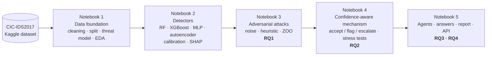

# Confidence-Aware and Adversarially Robust Cyber Threat Analysis

**Using Explainable Machine Learning and Evidence-Grounded AI Agents**

MSc Data Science Final Project · Spoorthi Hosakote Suresh · University of Hertfordshire

---

## Overview

Machine-learning intrusion detection systems (IDS) score highly on benchmark data, yet their predictions and SHAP explanations can be changed by small, realistic manipulations of network traffic. This project builds and evaluates a **confidence-aware decision mechanism** that combines three trust indicators for every network flow:

1. the classifier's **calibrated confidence**,
2. a **conformal anomaly p-value** from an autoencoder trained on benign traffic, and
3. the **robustness of the SHAP explanation** (similarity to the typical explanation of the predicted class, the novel indicator).

From these, the mechanism decides whether to **accept** a flow, **flag** it for more evidence, or **escalate** it to an analyst. Flagged flows are analysed by **evidence-grounded LLM agents** (Gemma 4, LangGraph, retrieval over MITRE ATT&CK) whose claims are checked by a deterministic verifier. The mechanism is also deployed as a **FastAPI REST service** with a Docker configuration.

**Main research question:** *Is there a confidence-based decision-making algorithm that combines classifier confidence, anomaly evidence and explanation robustness, and makes an intrusion detection system more robust to attacks?*

| | Research question | Notebook |
|---|---|---|
| **RQ1** | How does controlled adversarial perturbation affect the detection performance and explanation stability of the selected IDS models? | 3 |
| **RQ2** | Can a confidence-aware decision mechanism identify cases where the classifier, the anomaly detector and the explanation disagree? | 4 |
| **RQ3** | Does the mechanism improve detection reliability compared with individual models and a conventional multi-agent baseline? | 5 |
| **RQ4** | What trade-offs arise between robustness, detection performance, latency and computational cost? | 5 |

---

## Key results (reported run)

| | Result |
|---|---|
| **Data** | CIC-IDS2017: 2,830,743 raw flows → **2,233,302** after removing 596,747 duplicates and 544 conflicting rows; leakage-safe stratified split; 2 attack families held out as never-seen |
| **Clean detection** | XGBoost macro-F1 **0.956** [0.950, 0.961] · Random Forest 0.946 · MLP 0.936 |
| **RQ1** | Under an adaptive black-box (ZOO) attack inside a validated threat model, macro-F1 falls **0.95 → 0.25** (XGBoost); SHAP rankings change significantly more than under random noise in 15 of 15 cases; 48.1 % of flows whose prediction did not change still had their explanation substantially changed |
| **RQ2** | At a 5 % false-flag budget on clean traffic, the mechanism keeps **96.0 %** of wrong decisions away from automatic acceptance (confidence alone: 41.4 %) and catches **91.4 %** of evasions by an adaptive attack never used for tuning. Explanation robustness beats confidence as an error signal (AUROC **0.867** vs 0.738) |
| **RQ3** | Accepted flows under attack reach macro-F1 **0.850** vs 0.602 for the detector alone; no established reliability gain from the LLM agents over a rules-only pipeline or a conventional multi-agent system |
| **RQ4** | Mechanism ≈ **8.7 ms** per flow; routing with the mechanism halves agent cost compared with a multi-agent system on every flow (1,506 vs 3,073 tokens; 29 vs 64 s per flow) |
| **Limits** | A defence-aware attacker reduces evasions caught from 92 % to 56 %; adversarial training is stronger against the attack it was trained on |
| **Deployment** | REST service reproduces the evaluated decisions for 100 % of 347 test flows; 9 of 9 API tests pass; 62 ms per flow end to end |

---

## Pipeline



Each notebook saves its outputs to `/kaggle/working/`; the next notebook finds them automatically when they are attached as inputs.

---

## Repository structure

```
├── README.md
├── DATASET.md                              # the CIC-IDS2017 data: source, files, labels, how to get it, citation
├── LICENSE                                 # MIT licence (code only; the dataset keeps its own terms)
├── requirements.txt                        # library versions of the reported run
├── .gitignore
└── notebooks/
    ├── 01_data_foundation.ipynb            # Part 1  · data cleaning, leakage-safe split, threat model, EDA
    ├── 02_detectors.ipynb                  # Part 2  · classifiers, anomaly detection, calibration, SHAP
    ├── 03_adversarial_attacks.ipynb        # Part 3  · attacks and explanation stability (RQ1)
    ├── 04_confidence_mechanism.ipynb       # Parts 4, 4b · decision mechanism and stress tests (RQ2)
    └── 05_agents_results_deployment.ipynb  # Parts 5–8 · agents, answers, threat reports, REST API (RQ3, RQ4)
```

Every notebook contains the code **and the outputs of the reported run**, so all results can be read without re-running. Each notebook starts with a guide (what it does, how to run it, key concepts, methodology, key results) and ends with a short summary of how to present it.

---

## Notebooks

| # | Notebook | What it does | Input | Hardware | Run time |
|---|---|---|---|---|---|
| 1 | `01_data_foundation` | Cleans the data, removes duplicates and conflicting labels, makes a leakage-safe split, fits the preprocessing on training data only, defines and validates the threat model (13 controllable / 33 dependent / 35 uncontrollable features), explores the data | CIC-IDS2017 dataset | CPU | ≈ 10–15 min (estimate) |
| 2 | `02_detectors` | Tunes (Optuna) and trains Random Forest, XGBoost and an MLP; compares class weights vs SMOTE; calibrates probabilities; trains Isolation Forest and an autoencoder with conformal p-values; clean evaluation, SHAP baseline, cost and overfitting checks | Output of 1 | GPU T4 | ≈ 20–40 min (estimate) |
| 3 | `03_adversarial_attacks` | Noise, heuristic and ZOO attacks within the threat model; macro-F1 under attack; transferability; SHAP stability (Kendall τ, Jaccard, RBO) with Wilcoxon tests | Outputs of 1–2 | GPU T4 | ≈ 1.5–2 h (estimate) |
| 4 | `04_confidence_mechanism` | Builds the three trust indicators and the accept / flag / escalate rule; ablation, risk–coverage, flow-level bootstrap, never-seen attacks; stress tests (defence-aware attack, adversarial training, seeds, analyst-workload sweep) | Outputs of 1–3 | GPU T4 | ≈ 30–60 min (estimate) |
| 5 | `05_agents_results_deployment` | LangGraph + RAG agents with Gemma 4 and a deterministic verifier; systems A–E compared; answers to all research questions; threat reports (one separate report per flow, searchable explorer, live report generator); FastAPI service with parity tests, latency and Docker files | Outputs of 1–4 | GPU T4 ×2, Internet | ≈ 9.3 h without LLM cache (Part 5) |

---

## How to run

### On Kaggle (recommended; this is how the reported run was produced)

Run the notebooks in order **1 → 2 → 3 → 4 → 5**. For each notebook:

1. **Create → New Notebook**, then **File → Import Notebook** and upload the `.ipynb` file.
2. In **Session options**, set the accelerator (see the table above). Turn **Internet on** for Notebook 5 only.
3. **+ Add Input**:
   - Notebook 1: the dataset [`chethuhn/network-intrusion-dataset`](https://www.kaggle.com/datasets/chethuhn/network-intrusion-dataset) (CIC-IDS2017, *MachineLearningCVE* CSV files).
   - Notebooks 2–5: the **outputs** of all earlier notebooks (**Your Work → Notebooks**).
4. **Save Version → Save & Run All**. The files written to `/kaggle/working/` become this notebook's output for the next one.
5. Check the **Final checks** section at the end of each Part (every row should show ✔).

**Notebook 5 also needs:**
- a Hugging Face access token, after accepting the Gemma licence on huggingface.co, added as a Kaggle secret named `HF_TOKEN` (**Add-ons → Secrets**);
- optionally, the output of an earlier run containing `nb5_agents/llm_cache.jsonl`, so cached LLM answers are reused and the run is much shorter;
- for a quick test of the setup, set `CONFIG["smoke_test"] = True` in Section 5.2 (10 + 10 flows).

### In a local Jupyter environment

The notebooks use two environment variables, so they also run outside Kaggle:

```bash
pip install -r requirements.txt
export IDS_INPUT_ROOT=/path/to/inputs       # folder containing the CIC-IDS2017 CSV files (and earlier outputs)
export IDS_WORK_ROOT=/path/to/working       # folder where every notebook writes its outputs
jupyter lab
```

Run the notebooks in order with the same `IDS_WORK_ROOT`; each one finds the outputs of the earlier ones by file name. Set `IDS_SKIP_INSTALL=1` to skip the package installation cell in Notebook 5. A CUDA GPU is strongly recommended for Notebooks 2–5.

---

## Threat reports (Part 7, Notebook 5)

Part 7 turns the mechanism's decisions and the agents' evidence-cited analyses into incident reports:

| Output | What it is |
|---|---|
| `threat_report/threat_report.html` | printable report: executive summary + selected incident cards |
| `threat_report/incidents/INC-001.html …` | one separate report per flow, numbered from most to least severe |
| `threat_report/incident_explorer.html` | searchable page (opens in any browser): type an incident number (`7`, `INC-007`), a sample ID (`s120`) or keywords (`critical`, `DoS`, `escalated`, `T1498`); one report is shown at a time, with Previous / Next, Print and Download |
| Live generator (Section 7.3) | type an incident number or sample ID in the notebook; the report is generated from the data on the spot (`show_incident("INC-007")` also works without the input box) |

Part 7 runs on its own in about a minute without a GPU: attach the outputs of Notebooks 4 and 5, run the setup cell at the top of Notebook 5, then the Part 7 cells.

---

## Reproducibility

- Random seed **42** throughout; the seed-robustness test (Notebook 4, Section 4b.4) retrains with seeds 1, 2 and 3.
- Every statistic that learns from data (imputation, capping, scaling, feature selection, thresholds) is fitted on the training or tuning split only; the test set is evaluated once.
- Each Part ends with automated checks (for example, 17 of 17 data checks pass in Notebook 1).
- LLM answers are cached (`llm_cache.jsonl`) so a re-run reproduces them; generation uses temperature 0.
- GPU non-determinism causes small differences between full runs (for example, errors handled by system E were 89.9 % and 93.7 % in two runs); every conclusion about which differences are established was the same in both.

---

## Deployment (REST API)

Notebook 5 (Part 7b) packages the mechanism as a FastAPI service in `nb7b_deployment/ids_service_deploy/` (also saved as `ids_service_deploy.zip`). It needs no GPU or PyTorch.

```bash
unzip ids_service_deploy.zip -d ids && cd ids
docker compose up --build        # then open http://localhost:8000/docs
```

| Endpoint | Purpose |
|---|---|
| `GET /health` | liveness and readiness (200 once the models are loaded) |
| `GET /v1/model-info` | model versions, classes, thresholds and the features a flow should contain |
| `POST /v1/score` | score one or more flows (raw CICFlowMeter features) → predicted family, confidence, anomaly p-value, explanation stability, failed checks, decision and route (`agent_queue` = flag, `analyst` = escalate) |
| `POST /v1/score/csv` | score a CICFlowMeter CSV file; returns the rows with the decision columns added (or JSON) |
| `GET /metrics` | Prometheus metrics: requests and flows by decision (a rise in flag / escalate shares is an early sign of an attack or drift) |

If the environment variable `IDS_API_KEY` is set, every `/v1` request needs the header `X-API-Key`.

---

## Requirements

Library versions of the reported run (Python 3.13, Kaggle, Tesla T4): see `requirements.txt`. Main libraries: pandas, NumPy, scikit-learn, XGBoost, PyTorch, SHAP, Optuna, imbalanced-learn, Transformers, LangGraph, FastAPI.

---

## Data and ethics

- **Dataset:** CIC-IDS2017, Canadian Institute for Cybersecurity, University of New Brunswick ([dataset page](https://www.unb.ca/cic/datasets/ids-2017.html)); *MachineLearningCVE* version obtained from the [Kaggle mirror](https://www.kaggle.com/datasets/chethuhn/network-intrusion-dataset). The data is not included in this repository (see **[DATASET.md](DATASET.md)** for the files, labels, how to get them and how the project uses them); please cite the creators:
  > Sharafaldin, I., Lashkari, A.H. and Ghorbani, A.A. (2018) 'Toward generating a new intrusion detection dataset and intrusion traffic characterization', *Proceedings of the 4th International Conference on Information Systems Security and Privacy (ICISSP)*, pp. 108–116.
- The data were generated on a testbed with simulated users and contain only flow statistics (no payloads, no IP addresses). No human participants were involved.
- Adversarial attacks are simulated only in feature space, inside a stated threat model, on a public lab dataset; no exploit code is produced.
- The LLM runs locally, so no traffic data leaves the environment, and the agents never act automatically: uncertain flows are escalated to a human analyst.

---

## Limitations

One lab dataset with known labelling issues and single-day attack families; feature-space (not packet-level) attacks; a defence-aware attacker still gets 44 % of its evasions past the mechanism; small open LLMs evaluated on 200 weighted flows; the MLP batch size was fixed at 1,024. Full discussion in the report (Section 6.4).

---

## Licence

The code in this repository is released under the [MIT License](LICENSE). The CIC-IDS2017 dataset is not part of this repository and remains subject to its creators' terms.

---

## Citation

If you use this work, please cite:

> Hosakote Suresh, S. (2026) *Confidence-Aware and Adversarially Robust Cyber Threat Analysis Using Explainable Machine Learning and Evidence-Grounded AI Agents*. MSc Data Science Final Project, University of Hertfordshire.
